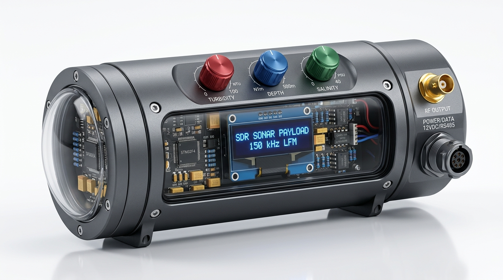

# 🖼️ Engineering Visual Guide — Architecture, Testbench & Subsea Enclosure
**Project**: Intelligent Self-Monitoring Adaptive Sonar Transmitter for AUVs (SIH 2026 — PS 26058)

---

## 1. 🔄 Multi-Layer System Simulation Pipeline

The diagram below details the 4-module simulation pipeline utilized to validate the digital signal processing math, analog active filter, firmware execution, and ocean physics prior to circuit assembly.

### Technical Subsystem Breakdown:
1. **Module 1: Python DSP Engine**
   - Formulates the Linear Frequency Modulated (LFM) chirp equations $s(t) = \sin(2\pi(f_0 t + \frac{\mu}{2}t^2))$.
   - Applies discrete **Tukey ($\alpha=0.25$)** cosine tapering to suppress range sidelobes below $-42\text{ dB}$.
   - Computes Short-Time Fourier Transforms (STFT), spectrograms, and correlation functions.
   - Quantizes values to 12-bit unsigned integers ($0\text{ to }4095$) and exports C lookup tables (`chirp_lut.h`).
2. **Module 2: LTspice Analog Verification**
   - Simulates the 4th-Order Sallen-Key Active Low-Pass Filter with dual op-amp stages (AD8065 / OPA350 / TL072).
   - Generates AC sweep Bode magnitude/phase plots verifying cutoff at $f_c \approx 600\text{ kHz}$ (ultrasonic) and $15.9\text{ kHz}$ (audio baseband) with $-80\text{ dB/decade}$ stopband roll-off.
   - Verifies Total Harmonic Distortion ($\text{THD} < 0.20\%$).
3. **Module 3: Ocean Acoustic Model**
   - Implements the empirical **Francois-Garrison (1982) formulation** for frequency-dependent acoustic attenuation ($\alpha$ in $\text{dB/km}$).
   - Evaluates turbidity scattering loss, depth pressure effects, and temperature relaxation frequencies to feed the Stage 1 Prior.
4. **Module 4: Proteus VSM Co-Simulation Hub**
   - Simulates the virtual STM32 ARM core running compiled `.hex` firmware.
   - Streams sample data to the DAC using hardware master timer `TIM6_TRGO`.
   - Drives the virtual Sallen-Key filter and plots real-time waveforms on the virtual oscilloscope.

---

## 2. 🔬 Laboratory Bench Testbench & Oscilloscope Measurement Setup

The benchtop mixed-signal qualification setup verifies the real-time transition from raw DAC quantization steps to a smooth reconstructed analog chirp.

### Oscilloscope Channel Allocation:
* **Channel 1 (Yellow Trace - Top)**: Raw 12-bit DAC output (Pin PA4) showing discrete quantization staircase levels and zero-order hold (ZOH) switching steps.
* **Channel 2 (Cyan Trace - Bottom)**: Output of the 4th-order Sallen-Key active reconstruction filter showing the smooth, continuous analog LFM chirp with suppressed Nyquist harmonics.
* **Workstation Telemetry (Left)**: Real-time spectrogram waterfall confirming continuous linear frequency sweep over time.

---

## 3. 🚢 Subsea AUV Watertight Payload Enclosure Design

Mechanical packaging design for the subsea transmitter payload module designed for standard AUV hull slots (e.g., BlueROV2 / modular marine vehicle payload bays).

### Mechanical & Interface Specifications:
* **Enclosure**: CNC-machined / 3D-printed hard-anodized marine-grade 6061 aluminum housing with dual Viton O-ring seals.
* **Sensory Calibration Dials**: Three sealed rotary potentiometers for benchtop calibration:
  - **Turbidity Control (0–100 NTU)**
  - **Depth Control (0–500 m)**
  - **Salinity Control (0–40 PSU)**
* **Internal Electronics**: STM32 Nucleo/custom carrier PCB, dual op-amp active filter stage, and $0.96\text{"}$ OLED diagnostic screen (`SDR SONAR PAYLOAD`).
* **Subsea Penetrations**: High-pressure BNC transducer output port and IP68 waterproof power/telemetry bulkhead connector.
